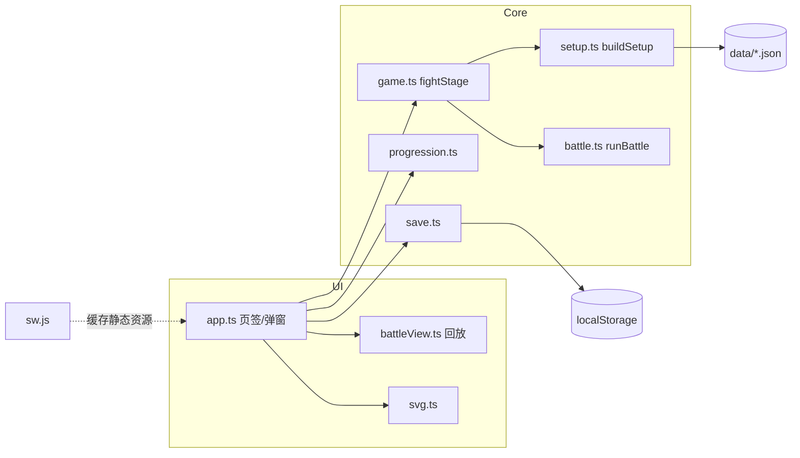
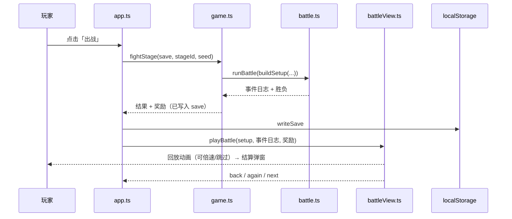

# 架构与设计说明

## 1. 目标与原则
1. **核心逻辑与界面分离**：战斗、成长、存档是不依赖 DOM 的纯 TypeScript，可在 Node 里完整测试。
2. **数据驱动**：武将、技能、羁绊、关卡全部是 JSON，技能由「效果列表」拼装，新增内容不改引擎。
3. **确定性**：战斗只依赖输入配置与种子，输出事件日志；界面仅回放。
4. **轻量、手机优先**：无游戏引擎，DOM + SVG，生产包 JS 约 50 KB（gzip 17.7 KB）。

## 2. 技术选型与理由
| 选择 | 理由 | 备选及放弃原因 |
|---|---|---|
| TypeScript strict + Vite | 类型保护数据结构；构建快；开箱支持 PWA 静态部署 | — |
| DOM + 内联 SVG | 卡牌/血条/弹窗类 UI 用 DOM 最省力；SVG 可程序化生成「占位立绘」且清晰缩放 | Phaser/Pixi：包体大，对回合制卡牌收益小（需要粒子/骨骼动画时再引入） |
| 手写 Service Worker | 需求简单（缓存静态资源），避免插件依赖 | vite-plugin-pwa |
| Vitest + Ajv | 与 Vite 同栈；Ajv 做 JSON Schema 校验 | — |
| Playwright-core + 系统 Chrome | 移动端模拟 E2E 与截图 | 下载整套浏览器，体积大 |

## 3. 分层与目录
```
src/
  core/    纯逻辑（无 DOM）
    types.ts        全部类型
    rng.ts          mulberry32 种子随机
    battle.ts       战斗引擎 runBattle(setup) → 事件日志
    setup.ts        存档+关卡 → BattleSetup；属性/羁绊/战力计算
    progression.ts  升级/进阶/成本公式
    game.ts         fightStage：战斗 + 奖励结算 + 解锁
    save.ts         存档读写、迁移、清洗、解锁判断
  data/    JSON 内容 + index.ts（按 id 查询）
  ui/
    app.ts          应用壳：页签、弹窗、事件委托、与存档/战斗对接
    battleView.ts   战斗回放（事件日志 → 动画）
    svg.ts          占位立绘生成
    styles.css      深色主题、竖屏布局
  main.ts           入口：挂载 UI、注册 Service Worker
public/             manifest、sw.js、图标
docs/               本文档集与 JSON Schema
tests/              单元/数据/平衡测试 + e2e/smoke.mjs
scripts/            图标生成、截图
```
依赖方向：`ui → core → data`，`core` 不引用 `ui`。

## 4. 模块视图


## 5. 关键流程：一场战斗

注意：结果与奖励在**开战时**就已结算并存盘（先算后演）。这避免了动画期间关闭页面导致的存档不一致，也让「跳过」零成本；代价是中途退出仍计入结果（已列为已知缺口）。

## 6. 关键设计决策
| 决策 | 说明 |
|---|---|
| 事件日志而非回调 | 引擎不知道动画；UI 逐事件更新血条/怒气/飘字，方便测试与未来录像 |
| 速度排序而非固定出手顺序 | 每回合重排，速度增益/减益会实时改变顺序；顶部「行动顺序条」让玩家看见顺序 |
| 合击作为羁绊上的可选字段 | 数据中描述，引擎只做「发起者 + 其余成员存活」判断，扩展新合击无需改代码 |
| 存档先清洗再使用 | `sanitize()` 兜底，使内容更新（删除武将）不会弄坏旧档 |
| 种子随机 | 平衡模拟与单元测试可复现 |
| 事件委托 | 整个页面一个 click 监听（`data-act`），重绘后不必重绑事件 |

## 7. PWA 设计
- `manifest.webmanifest`：`display: standalone`，`orientation: portrait`，192/512/maskable 图标，主题色 `#1a1411`。
- `sw.js`：对同源 GET 请求采用 stale-while-revalidate，缓存名 `sgsnl-v1`；发布新版需更换缓存名以清旧缓存。
- 注册路径使用相对路径 `./sw.js`，`vite.config.ts` 设 `base: './'`，因此可部署在任意子路径。
- **安装条件**：浏览器只在 HTTPS 或 `localhost` 下启用 Service Worker 与「安装」。用局域网 `http://192.168.x.x` 访问仍可游玩与「添加到主屏幕」（书签式快捷方式），但没有离线缓存；要完整 PWA 请部署到任一 HTTPS 静态托管（GitHub Pages / Netlify / Cloudflare Pages 等，直接上传 `dist/`）。

## 8. UI 结构
- 页签：出征（关卡列表）/ 阵容（3+3 站位 + 候补）/ 武将（卡片 + 详情弹窗：升级、进阶）/ 羁绊。
- 战斗屏：顶栏（章节/关卡、回合、倍速、跳过）→ 行动顺序条 → 敌方 2 排 → VS 线 → 我方 2 排 → 日志栏 + 图例。
- 适配：`100dvh`，`env(safe-area-inset-*)`，`#app` 最大宽度 480px；小屏（高 ≤ 740px）隐藏图例并缩小头像。

## 9. 扩展点
| 想做 | 改哪里 |
|---|---|
| 新武将/技能 | `generals.json`（复用已有 Effect） |
| 新状态/新效果类型 | `types.ts` 加 Effect → `battle.ts` 的 `applyEffect` → `common.schema.json` → 测试 |
| 新章节 | `stages.json` 增加 `chapter: 2`，界面增加章节切换 |
| 换美术 | 用 `` 替换 `svg.ts` 的 `portrait()` 返回值 |
| 联网存档 | 把 `loadSave/writeSave` 换成接口，存档 Schema 已有版本号 |
