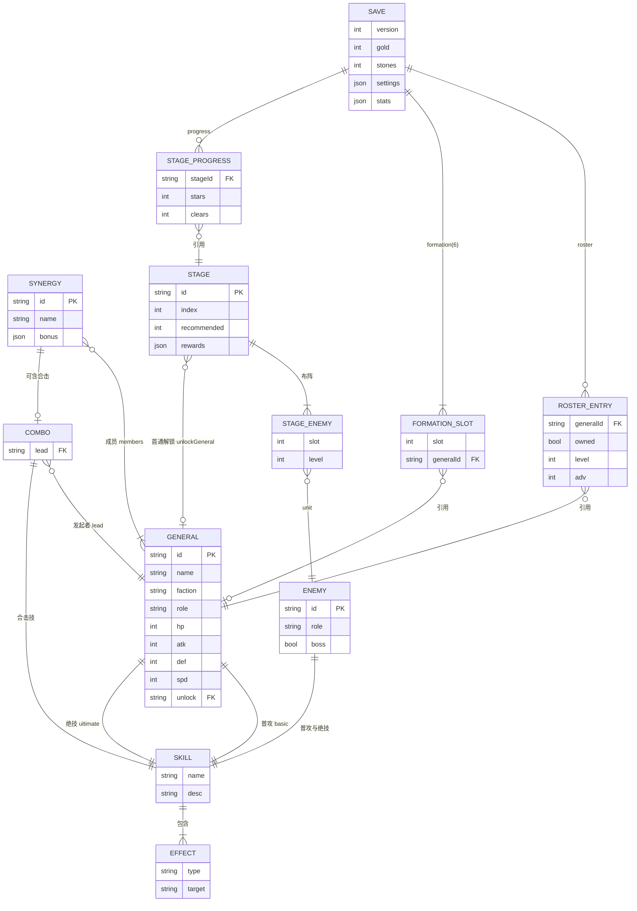

# 数据模型与存储设计

本文覆盖：实体定义、JSON Schema（静态数据）、`localStorage` 存档结构与版本迁移、ER 图。
类型定义的权威来源是 `src/core/types.ts`；Schema 在 `docs/schema/`，由 `tests/data.test.ts` 在每次测试时校验全部数据。

## 1. 数据分层

| 层 | 内容 | 位置 | 可变性 |
|---|---|---|---|
| 静态数据（内容） | 武将、敌人、羁绊、关卡 | `src/data/*.json` | 只读，随版本发布 |
| 动态数据（存档） | 货币、已拥有武将与等级、阵容、通关进度、设置 | `localStorage['sgsnl.save']` | 读写 |
| 运行时数据 | 战斗单位、事件日志 | 内存（不持久化） | 临时 |

武将 id、关卡 id 等是静态数据与存档之间的**外键**；存档读入时经 `sanitize()` 剔除不再存在的 id。

## 2. 实体定义

### 2.1 General（武将）`src/data/generals.json`
| 字段 | 类型 | 说明 |
|---|---|---|
| id | string (kebab-case) | 主键，如 `cao-cao` |
| name / title | string | 姓名 / 称号 |
| faction | `shu` \| `wei` | 阵营 |
| role | `warrior` \| `strategist` \| `guardian` \| `support` | 定位 |
| hp / atk / def / spd | integer ≥ 1（def ≥ 0） | 1 级、0 阶时的四维 |
| basic / ultimate | Skill | 普攻 / 绝技 |
| look | Look | SVG 占位形象参数 |
| bio | string | 简介 |
| unlock | `"start"` 或关卡 id | 初始拥有，或通关该关后获得 |

### 2.2 Skill 与 Effect
```
Skill  { name, desc, effects: Effect[] }
Effect = damage {mult, target, hits?, lifesteal?}
       | heal   {mult, target}            // 治疗量 = 施法者攻击 × mult
       | shield {mult, target}            // 护盾 = 施法者最大生命 × mult
       | buff   {stat: atk|def|spd, pct, turns, target}   // pct 可为负（减益）
       | dot    {mult, turns, target}     // 每回合 施法者攻击 × mult，无视防御
       | rage   {amount, target}
       | taunt  {turns}
       | silence{turns, target}
target = enemy-front | enemy-back | enemy-back-2 | enemy-all | enemy-lowest-hp
       | enemy-top-atk | self | ally-all | ally-lowest-hp
```

### 2.3 Enemy（敌人）`src/data/enemies.json`
与 General 同构（`UnitBase`），无 faction/bio/unlock，多 `boss?: boolean`。7 个：黄巾兵/弓手/力士/术士 + 张梁/张宝/张角（Boss）。

### 2.4 Synergy（羁绊）`src/data/synergies.json`
| 字段 | 说明 |
|---|---|
| id, name, desc | 标识与文案 |
| members | 2–3 个武将 id；全部在阵上时激活 |
| bonus | `{hp?,atk?,def?,spd?}` 百分比（0.10 = +10%），乘算到上阵成员 |
| combo? | `{lead, skill}`：发起者与合击技；其余成员存活为释放条件 |

当前 4 个：桃园同心（刘备/关羽/张飞：生命、攻击 +10%）、卧龙腾云（诸葛亮/赵云：攻击 +12%）、谋定天下（曹操/郭嘉：速度 +6%，**合击「雷霆定策」**）、虎卫长城（夏侯惇/许褚：防御 +15%、生命 +6%）。

### 2.5 Stage（关卡）`src/data/stages.json`
| 字段 | 说明 |
|---|---|
| id / chapter / index / name / intro | 标识与文案；`index` 1–10 |
| recommended | 建议战力（仅作提示） |
| enemies[] | `{unit, slot(0–5), level}`，同一关内 slot 不重复 |
| rewards | `{gold, stones, firstClearGold, unlockGeneral?}` |

### 2.6 SaveData（存档）见 §4

## 3. 静态数据 JSON Schema
均位于 `docs/schema/`（Draft-07）：

| 文件 | 校验对象 |
|---|---|
| `common.schema.json` | 共用定义：Skill、Effect、Look、Role、Faction、TargetSel 等 |
| `general.schema.json` | `generals.json`（数组） |
| `enemy.schema.json` | `enemies.json` |
| `synergy.schema.json` | `synergies.json` |
| `stage.schema.json` | `stages.json` |
| `save.schema.json` | 存档对象 |

校验之外，`tests/data.test.ts` 还检查**引用完整性**：羁绊成员存在、合击发起者属于成员、关卡敌人存在、解锁武将存在且每个非初始武将恰好由一个关卡解锁。

## 4. 存档设计

### 4.1 键
| localStorage 键 | 内容 |
|---|---|
| `sgsnl.save` | 当前存档（JSON） |
| `sgsnl.save.bak` | 不兼容/损坏存档的备份（只保留最近一份） |
| `sgsnl.seen` | 新手引导已看标记（`"1"`） |

### 4.2 结构（版本 1）
```json
{
  "version": 1,
  "createdAt": 1790000000000,
  "updatedAt": 1790000000000,
  "resources": { "gold": 300, "stones": 0 },
  "roster": {
    "liu-bei": { "owned": true, "level": 1, "adv": 0 }
  },
  "formation": ["guan-yu", "xu-chu", "xiahou-dun", "liu-bei", "cao-cao", null],
  "progress": { "stage-01": { "stars": 3, "clears": 2 } },
  "settings": { "speed": 1 },
  "stats": { "battles": 0, "wins": 0 }
}
```
约束（`save.schema.json`）：`version` 为常量 1；`level` 1–25；`adv` 0–3；`formation` 恰好 6 项，元素为武将 id 或 null，不重复；`stars` 0–3；`speed` ∈ {1,2,4}。

新档初始：银两 300、5 名初始武将（刘备、关羽、曹操、夏侯惇、许褚）、阵容已预置 5 人。

### 4.3 读写流程
```
读取：getItem → JSON.parse
        ├─ 解析失败 → 备份原文到 .bak，新建存档
        └─ 成功 → migrate(raw)
                   ├─ version 缺失/<1/>当前 → null → 备份 + 新建（不解释未来版本）
                   └─ 逐级应用 MIGRATIONS[v] 升到当前版本 → sanitize()
写入：每次状态变化（升级、进阶、换阵、战斗结算、设置）后整体 setItem，并更新 updatedAt
```

### 4.4 版本策略
- 任何**不向后兼容**的字段变更都必须：① `SAVE_VERSION` +1；② 在 `MIGRATIONS[旧版本]` 中写迁移函数；③ 更新 `save.schema.json` 与测试；④ 记入 CHANGELOG。
- 目前为 v1，迁移表为空（已有测试验证「未来版本不被解释」与「坏档被备份」）。
- `sanitize()` 兜底：剔除未知武将 id，修正越界的等级/进阶，去重阵位，补全缺失字段。因此**新增武将/关卡**（仅内容增加）不需要升版本。
- 已知限制：`localStorage` 约 5 MB 且可被浏览器清除；暂无导入/导出。

## 5. ER 图



## 6. 运行时数据：战斗事件
`runBattle()` 产出有序事件日志（`start / round / turn / cast / damage / heal / shield / rage / buff / status / death / end`），UI 仅按序回放，不参与计算。类型见 `types.ts` 的 `BattleEvent`。这使战斗可重放、可断言、可未来用于录像或联机校验。
